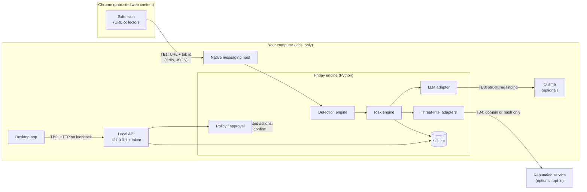

# Friday: Architecture

This doc covers how Friday is split into parts, how data moves between them, and where the trust boundaries are. The requirement IDs (FR-*, NFR-*) refer to [REQUIREMENTS.md](REQUIREMENTS.md). The threats and mitigations for each boundary are in [THREAT_MODEL.md](THREAT_MODEL.md).

## Overview



## Components

The eight parts have one job each. They only talk to each other through the typed interfaces described below.

| # | Component | Job | Runs as |
|---|---|---|---|
| 1 | **Browser collector** | Sends the active tab's URL to the engine when the tab changes. Nothing else from the page | Chrome MV3 extension (service worker) |
| 2 | **Detection engine** | Parses and normalizes the URL, then runs deterministic rules. Each rule returns a `Signal` | Python library |
| 3 | **Threat-intel adapters** | Optional reputation lookups. Off by default, sends the smallest indicator possible, caches results | Python library |
| 4 | **Risk engine** | Turns signals (and any intel result) into a `Finding` with severity, confidence, verdict, and limitations | Python library |
| 5 | **LLM adapter** | Asks a local model to explain a finding in plain words. Can't change the verdict or trigger anything | Python library, talks to Ollama over loopback HTTP |
| 6 | **Policy / approval** | The only thing allowed to propose or carry out an action. Fixed allowlist, needs your confirmation, logs every outcome | Python library |
| 7 | **Desktop app** | Dashboard, finding details, history, settings, consent screens | Tauri + React (fallback: local web UI) |
| 8 | **Storage** | Settings, findings, feedback, intel cache, and audit log, with retention and delete-all | SQLite (WAL mode) with migrations |

The detection, risk, intel, LLM, policy, and storage parts all live in one Python package (`engine/`). They're separate modules rather than separate services, because there's no reason to pay for extra processes and ports on a personal machine. The package has two entry points:

- **Native messaging host** (`friday-host`): Chrome starts it and talks to it over stdin/stdout.
- **Local API** (`friday-api`): a small FastAPI app that only the desktop app uses.

Both entry points share the same SQLite file. WAL mode lets the API read while the host writes.

## Why native messaging for the extension

The two options I considered for connecting the extension to the engine:

| | Native messaging | HTTP on 127.0.0.1 |
|---|---|---|
| Open port | None | Yes. Any local process or web page can try to reach it |
| Caller identity | Chrome only launches the host for extension IDs listed in the host manifest (`allowed_origins`) | Needs a token, origin checks, and Host-header checks |
| DNS rebinding / CSRF from websites | Not possible, because there's no listener | Has to be defended against explicitly |
| Cost | A host manifest has to be installed per browser and OS | Simpler to develop |

Native messaging removes a whole class of local-API attacks from the browser path, so I'm using it there. The desktop app still needs an API, so that one is locked down as described next.

## Local API rules (desktop only)

- Binds to `127.0.0.1` only, never `0.0.0.0` (NFR-2).
- Every request needs a bearer token. The token is random (32 bytes), created at first run, and stored in a file only the user can read (`0600`). The desktop app reads it from there.
- It rejects any `Host` header other than `127.0.0.1:<port>` or `localhost:<port>`. This blocks DNS rebinding.
- No CORS headers, so web pages can't read responses.
- Request and response bodies are validated against the same schemas the engine uses. Unknown fields are rejected.
- The API is read-mostly. Anything that changes the system goes through the policy layer and needs your confirmation in the UI.

## Main data flow: checking a URL

1. A tab finishes navigating. The extension takes the URL and **drops the fragment** (`#...`) before sending.
2. The extension sends `{type: "analyze_url", url, tab_id, ts}` to the native host.
3. The host validates the message (size cap, schema, `http(s)` only) and passes the URL to the detection engine.
4. The detection engine normalizes the URL (IDN → punycode, lowercase host, default ports removed, `userinfo` flagged) and runs its rules. Each rule returns zero or more `Signal`s with an id, a description, the evidence, and a weight.
5. If you've turned intel on, the risk engine asks the intel adapter about the **registered domain only** (unless you've opted in to more). A failure or timeout counts as `unknown`.
6. The risk engine produces a `Finding`: verdict (`not_detected` / `unknown` / `suspicious`), severity, confidence, signals, limitations, and the rule-set version.
7. The finding is saved. Before saving, the query string is reduced to parameter **names** only, not values, so tokens in URLs aren't stored.
8. The host replies to the extension with the verdict, severity, and a short reason. The extension shows a badge, or a warning if the result is `suspicious`.
9. Later, if AI is enabled and you open the finding in the desktop app, the LLM adapter asks for an explanation. The explanation is checked against a schema and stored next to the finding. It never replaces the verdict.

## Data contracts (outline)

These get properly defined and tested later. This is the shape they're expected to have:

```text
Signal       { id, title, evidence: dict, weight: float, rule_version }
Finding      { id, created_at, subject: {kind: "url", value_redacted, host},
               verdict: not_detected|unknown|suspicious,
               severity: none|low|medium|high, confidence: low|medium|high,
               signals: [Signal], intel: [IntelResult], limitations: [str],
               user_feedback: none|benign|incorrect }
IntelResult  { provider, indicator_sent, status: hit|miss|error|disabled, fetched_at }
Explanation  { finding_id, model, facts: [str], uncertainty: [str],
               recommendations: [str], generated_at }
ActionRequest{ id, finding_id, action: <allowlisted enum>, params, status:
               proposed|approved|declined|done|failed, decided_at }
```

## Trust boundaries

| ID | Boundary | What crosses it | Main control |
|---|---|---|---|
| TB1 | Browser → native host | URL, tab id, timestamp | Chrome's `allowed_origins`, schema validation, size limit |
| TB2 | Desktop app → local API | Settings, finding queries, action approvals | Loopback-only bind, token, Host check, schema validation |
| TB3 | Engine → local LLM | Structured finding (no page content) | Prompt template treats all fields as data; output schema check; model has no tools |
| TB4 | Engine → external intel | Registered domain or file hash | Off by default, consent screen, minimal indicator, timeouts |
| TB5 | Policy layer → operating system | Allowlisted action, e.g. reveal a file in Finder | Fixed allowlist, explicit confirmation, audit log |
| TB6 | Engine → disk | Findings, settings, cache, logs | Redaction before writing, file permissions, retention, delete-all |

Data comes in from the web (a URL can say anything), from the LLM (its output is untrusted text), and from intel providers (their responses are untrusted input too). Everything from those sources is validated and handled as data, never as instructions.

## What runs where, and with what privileges

- Everything runs as the normal logged-in user. No admin or root (NFR-3).
- Ollama is optional. If it isn't running, explanations are simply switched off (FR-L5).
- Nothing in Friday listens on a network interface other than loopback.

## Not decided yet

- Desktop shell: Tauri needs a Rust toolchain. The fallback is a local web UI served by `friday-api` (roadmap D2).
- Which intel provider to try first. That depends on its terms and privacy policy, and gets decided when the adapter is built.
- How the native host manifest gets installed on Windows (a registry key) versus macOS (a JSON file in the Chrome profile directory). For now I'm designing for both, but only macOS will be tested at first.
